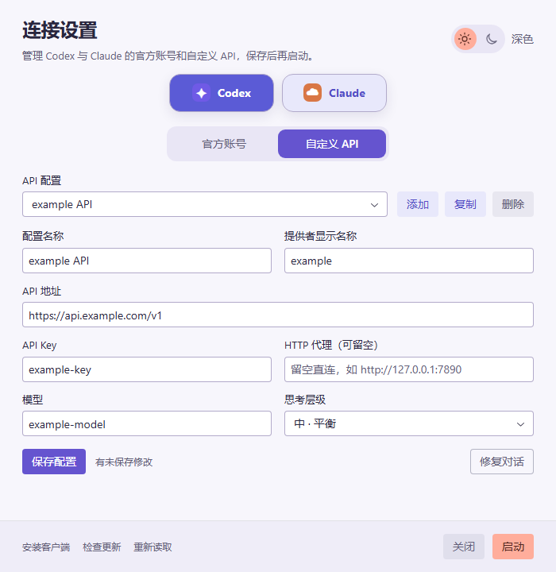

# acs

管理 Codex 与 Claude 的官方账号、自定义 API、独立代理和 Agent 环境。采用 Rust 共享核心、Tauri 桌面界面和独立命令行入口。AGS 的环境管理能力已并入 acs，AGS 退役；环境数据继续保存在独立私有 Git 仓库。

[下载发布版本](https://github.com/shellus/acs/releases/latest) · [账号与 CLI](docs/features/usage.md) · [Agent 环境](docs/features/agent-environment.md) · [架构和行为边界](docs/dev-spec/application-behavior.md)

## 支持范围

| 平台 | 入口 | 分发依赖 |
| --- | --- | --- |
| Windows x64 | Tauri GUI（`acs-gui.exe`）、CLI（`acs.exe`） | GUI 使用 WebView2；安装包可在缺失时安装运行时，便携 EXE 要求已安装 WebView2 |
| macOS Apple Silicon | Tauri GUI（`.app`）、CLI | GUI 使用系统 WKWebView；桌面目标是 Electron 版 Codex.app |
| Linux x64 | 独立 CLI | musl 静态二进制，不依赖 Tauri、WebView、Node.js 运行时或外部 SQLite 动态库 |

账号命令不要求安装 git、Node.js 或 npm。环境同步与仓库维护在运行时调用系统 git、Node.js/npm；CLI 二进制本身不捆绑这些工具。仅解析本地声明的 `env validate`、保存来源和本机选择不调用外部工具。

macOS 原生 ChatGPT.app 不等同于 Electron Codex.app，不能套用相同的域名阻断参数。

Codex 与 Claude 各自独立生效：可以 Codex 停在官方账号，同时 Claude 走自定义 API。两边的草稿在同一窗口编辑，切换客户端不丢失编辑。

## 桌面使用

1. 打开应用，选择 Codex 或 Claude，再选择“官方账号”或“自定义 API”，添加或选择配置。
2. 填写并点击当前页的“保存配置”。保存不会启动或停止客户端。
3. 点击底部“启动”。未保存修改或外部配置变化会阻止启动，并保留草稿。

官方账号可通过官方客户端登录；Codex 还支持 CLI 生成 PKCE 授权链接，在其他机器的浏览器登录后将完整回调 URL 粘贴回终端。后续 token 刷新由官方客户端负责；本地存在凭据不代表账号有效。Claude 桌面版与 Claude Code 命令行的登录互不共享：acs 按账号保存并切换命令行的 `~/.claude/.credentials.json`，新增或尚未登录的 Claude 官方账号保存后命令行处于未登录状态，需在终端运行 `claude /login`，之后 acs 会把凭据归到该账号。桌面版的登录态由桌面版自己保存，acs 只切换 1P/3P，不切换桌面版登录的官方账号。官方模式可设置客户端共用的 HTTP 代理，每条自定义 API 配置也可单独设置代理（海外中转站等）。Codex 自定义模式直连时只阻断 Electron 外壳的指定云端域名，不阻断内置 app-server 访问自定义 API；配置了代理时改走代理，不再阻断。

Claude 桌面版的自定义 API 通过它的第三方推理（3P）配置生效，保存时同步写入；桌面版只接受 `claude-*` 模型名，配置了其他模型名时阻止启动桌面版（Claude Code CLI 不受影响），留空则使用中转站的 `/v1/models` 列表。桌面版只在启动时读取配置，已在运行时需完全退出后再启动。

Codex 只托管 `model_providers.custom`；手工添加的其他 provider 在保存和模式切换时原样保留，不进入 acs 配置快照。

关闭按钮、标题栏和 Esc 共用草稿确认。只有显式“修复对话”才改写 Codex 历史 provider ID，修复前创建备份。




## Agent 环境与 CLI 安装

Linux x86_64：

```sh
curl -fsSL https://raw.githubusercontent.com/shellus/acs/main/scripts/install.sh | bash
```

Windows x64 PowerShell：

```powershell
irm https://raw.githubusercontent.com/shellus/acs/main/scripts/install.ps1 | iex
```

脚本校验发布产物的 SHA-256，默认安装到 Linux `~/.local/bin/acs` 或 Windows `~/bin/acs.exe`；安装目录需在 PATH 中。CLI 与 GUI 独立分发，自更新只更新 CLI。

```sh
acs env source set https://example.com/agent-env.git --branch main
acs env configure --profile default --agents codex,claude
acs env status
acs env diff
acs env apply --yes
acs doctor
acs self version
acs self update --yes
```

运行 `acs` 后按 `v` / F3 进入 TUI 环境页，查看具体漂移、刷新、确认应用或诊断；耗时操作在后台显示实际阶段。全局指令与 Skills 由核心事务应用；环境页不进入 Tauri GUI。已使用 AGS 的机器通过显式 `acs env import-ags` 接管，步骤见[切换说明](docs/features/agent-env-cutover.md)。

来源和 Profile、路径与仓库格式见 [Agent 环境](docs/features/agent-environment.md)；锁定上游、生成 vendor、诊断、安装与更新见 [CLI 维护与分发](docs/features/cli-maintenance.md)。

## 开发与验证

终端运行 `acs` 进入全屏 TUI：两个客户端的活动配置始终可见，配置列表与完整详情并列，直接按键增改、切换、登录和显式启动；窄终端改为单栏。OAuth 临时退出全屏，输出可完整复制的授权链接。管道或重定向下无参仍输出列表，脚本可使用 `acs login <配置>`。跨机器可用 `export-custom` / `import-custom` 迁移自定义 API，导入不改动目标机器的活动配置。详见[CLI 用法](docs/features/usage.md#cli)。

`n` 先选择“官方账号 / 自定义 API”，官方账号只需名称；新增 Codex 官方账号保存后询问是否立即登录，可在确认处修改并保存官方代理。登录前显示实际换令牌路线，空官方代理沿用环境 / 系统代理，无可用代理才直连；直连可能受地区限制。未登录的 Codex 账号按 `l` 可再次进入登录确认，Claude 官方账号由 Claude 客户端自己登录。

需要 Rust stable、Node.js 24；Windows 构建需要 MSVC C++ 构建工具和 Windows SDK，macOS 构建需要 Xcode Command Line Tools。

```sh
npm ci
npm run build
cargo fmt --all -- --check
cargo test -p acs-core -p acs --locked
cargo clippy -p acs-core -p acs --all-targets -- -D warnings
cargo build -p acs --release --locked
```

Windows / macOS 桌面开发和打包：

```sh
npm run tauri -- dev
npm run tauri -- build
```

仅构建桌面可执行文件：`cargo build -p acs-gui --release --locked`，此前须完成 `npm run build`。Windows 产物为 `target/release/acs-gui.exe`，CLI 为 `target/release/acs`（Windows 带 `.exe`）。

```sh
npx playwright install chromium
npm test
```

Windows 可运行 `node scripts/desktop-smoke.mjs`，以临时 example 配置验证正式程序的实际 IPC、保存、冲突和关闭行为；可追加 EXE 路径以核对 CI 下载的发布文件。Rust 测试显式传入临时 Store；GUI 测试使用隔离 fixture，不修改真实用户认证。

CI 在 Windows、Linux、macOS 运行核心和 CLI 测试，构建 Windows/macOS GUI，并上传平台产物。行为验证与运行边界见[架构文档](docs/dev-spec/application-behavior.md)。

## 许可证

[GNU Affero General Public License v3.0](LICENSE)，SPDX：`AGPL-3.0-only`。历史 provider 修复的初始数据范围与备份思路参考 [Codex++](https://github.com/BigPizzaV3/CodexPlusPlus)。
